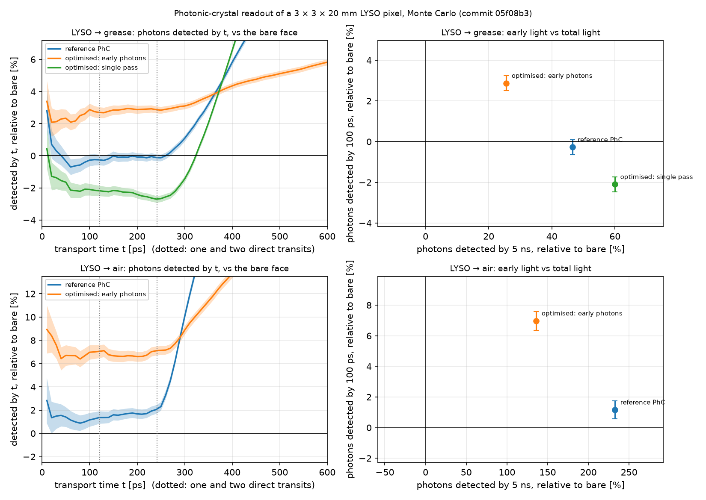

# phc-scintillator-extraction

**Inverse-designed photonic-crystal readout layer for scintillator light extraction and fast timing.**

> **Work in progress.** Milestones M0–M4 are done; M5 (robustness checks, final figures,
> technical note) is under way. Milestones, dates and what is validated are tracked in
> [PLAN.md](PLAN.md) and [docs/status.md](docs/status.md). Numbers are preliminary until
> the milestone that produces them is marked done.

Heavy inorganic scintillators such as LYSO (n ≈ 1.81) and BGO (n ≈ 2.15) trap most of
their scintillation light by total internal reflection, and the bouncing that follows
spreads photon arrival times at the photodetector. This project builds a reproducible
simulation chain for one scintillator pixel: angle-resolved RCWA (rigorous coupled-wave
analysis, via `torcwa`) of a periodic layer on the readout face, a Monte Carlo ray model
of the pixel that samples the RCWA lookup table including reflected diffraction orders,
and gradient-based optimisation of the layer geometry. The figures of merit are
light-extraction efficiency and the transport-time distribution of detected photons
(CDF and early-photon fraction). Unlike most published photonic-crystal designs, which
maximise total light yield, the objective here is weighted toward *early* photon
arrival, the quantity that matters for timing. Scope is photon transport only:
scintillation kinetics and the photodetector's single-photon time resolution are
outside the model and are stated as limitations.

## Result so far



The figure shows a Monte Carlo of a 3 × 3 × 20 mm LYSO pixel, 10⁶ photons per case, at
420 nm. The other five faces are polished, with an air gap and a mirror film.

- A readout layer optimised for photons arriving within 100 ps detects **+2.9 ± 0.4 %**
  more of them than the bare face with optical grease, and **+7.0 ± 0.6 %** in air.
- At 50 and 200 ps the gains are +2.3 to +2.9 % (grease) and +6.6 to +7.0 % (air).
- A Knapitsch-style photonic crystal and a layer optimised for total single-pass
  extraction give no early gain, or a loss (−2.1 ± 0.4 % with grease). They collect much
  more light by 5 ns (+46 % and +60 %).
- Timing and light yield call for different designs.

Numbers: `results/key_figure.json`, `results/m5_threshold_check.json`, and
[docs/status.md](docs/status.md) with all assumptions.

## Quick start (CPU only)

```powershell
python -m venv .venv
.\.venv\Scripts\Activate.ps1
python -m pip install torch==2.14.1 --index-url https://download.pytorch.org/whl/cpu
python -m pip install -e ".[dev]"
pytest            # fast tests only; slow ones are skipped by default
ruff check .
```

Heavy computations (benchmarks, convergence studies, lookup tables, Monte Carlo runs,
optimisation) run on GitHub Actions through the `compute` workflow, not on a laptop:

```bash
gh workflow run compute.yml -f job=benchmark -f config=configs/benchmark.json
gh run watch <run-id>
gh run download <run-id> -D results/benchmark/<run-id>/
```

Every figure in `docs/figures/` is regenerated by one command:

```bash
python scripts/make_figures.py
```

It downloads the merged outputs of the quoted remote runs (lookup tables, Monte Carlo
CSVs, run summaries) from a release of this repository, then redraws the figures.

The repository was re-created on 2026-10-17 to publish a clean history. Runs before
that date live in a private archive repository; their outputs are in the release, and
their commit hashes are mapped in [docs/history-rewrite.md](docs/history-rewrite.md).

## Layout

```
src/phcscint/        main package (see AGENTS.md for module ownership)
src/phcscint/xcheck/ independent cross-check implementations (owned by Argon)
tests/               pytest suite; CI runs all of it, laptops skip @pytest.mark.slow
scripts/             every number or figure in the docs is produced by a script here
configs/             parameter files for remote jobs (scripts/remote_job.py)
docs/derivations/    derivations behind each physics module
docs/decisions.md    design-decision log
docs/status.md       progress, numbers produced, open issues
docs/references.md   references with DOIs and how each was verified
```

## Limitations

These are stated in the derivations and in [docs/status.md](docs/status.md), with the
direction of each bias.
- **Photon transport only.** Not modelled:
  - scintillation rise and decay;
  - photodetector single-photon time resolution;
  - photodetector quantum efficiency and its angular response. Every photon that
    enters the grease or air counts.
- **One wavelength (420 nm)** for the designs and the Monte Carlo. LYSO's refractive
  index is taken as 1.81 with no dispersion, and the group index as n. Times are
  therefore underestimated by n/n_g; comparisons between readouts are unaffected.
- **Unpolarised light** at every interaction (no polarisation tracking).
- **An ideal, infinite lattice.** No edge effects on a 3 mm face, no fabrication
  disorder.
- **Wall reflectivity 0.95 is assumed** (no citable value found). It changes the light
  collected by 5 ns, not the early-photon yields. There is no bulk absorption.
- **Optimisation.** A local optimiser, from a few starts, on a coarse angle grid.
  Final designs are evaluated on finer tables. Sampling those tables adds about 0.5 %
  systematic error to the early yields.
- **Reference design.** The reference crystal is "Knapitsch-style", not the published
  geometry. Material constants are provisional.

## Disclosure

AI coding assistants (Claude Code by Anthropic, and a second agent referred to as
"Argon") were used in this repository under the rules in [AGENTS.md](AGENTS.md). They
wrote code, tests and tooling, drafted the derivations in `docs/derivations/`, and
made the design decisions logged in `docs/decisions.md`, which I review. I work
through every derivation (predict exercises and check questions), I write the
technical note myself, and I (Azizbek Eshmominov) take full responsibility for the
correctness of the physics and the results reported here. Every quantitative claim in
the documentation is produced by a script in this repository or taken from a cited,
verified source.

No code, data or designs from any prior internship or employer are included.

## Licence

MIT, see [LICENSE](LICENSE).
